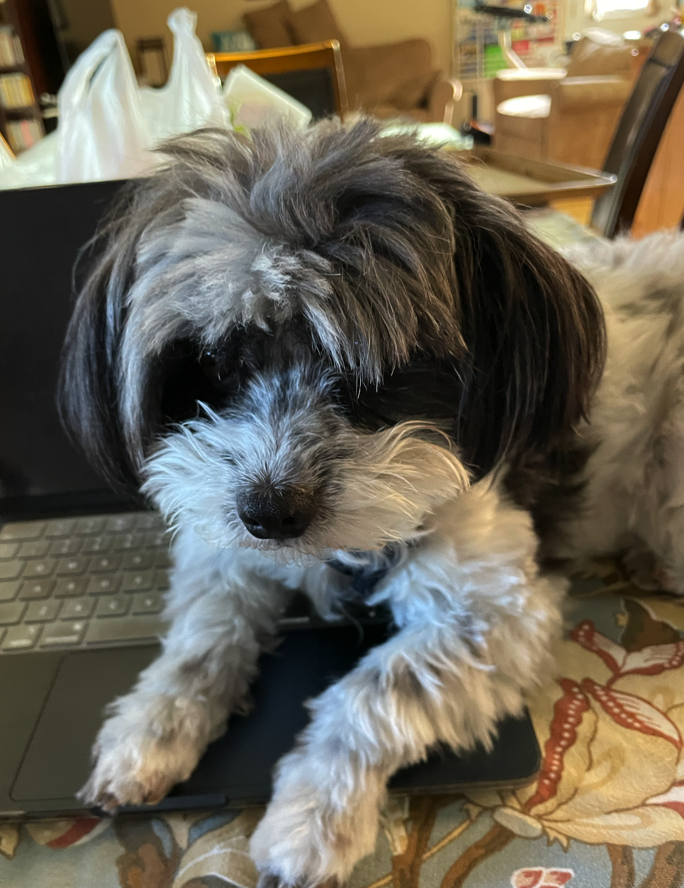

# Nicholas Chen
**Cybersecurity @ Northeastern University · Class of 2027**

---

## 👨‍💻 About Me

BS Cybersecurity · Minor in Law & Public Policy · ISC2 Certified in Cybersecurity
 
Interested in the intersection between Cybersecurity, Software Development, and Social Impact.
 
I learn, build, and take action.

---

## 💼 Experience

<b>Security Risk Analyst Co-op · Klaviyo</b> &nbsp;|&nbsp; Jul 2026 – Dec 2026

<b>President · FirstByte</b> &nbsp;|&nbsp; May 2025 – Present

<b>Software Engineer → Technical Lead · Code4Community</b> &nbsp;|&nbsp; May 2025 – Present

<b>Cybersecurity & Technology Audit Co-op · Liberty Mutual Insurance</b> &nbsp;|&nbsp; Jul 2025 – Dec 2025

<b>Cybersecurity Research Assistant · MonIOTr Lab @ Northeastern</b> &nbsp;|&nbsp; Jan 2026 – May 2026

---

Graduating Spring 2027 · Open to full time and internship security roles, research collabs, and CTF teams! · reach me at chen.nich@northeastern.edu

